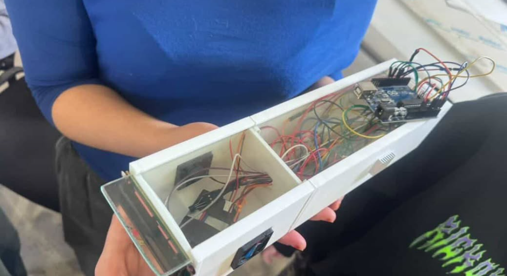
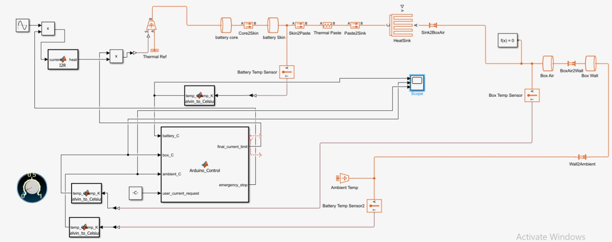
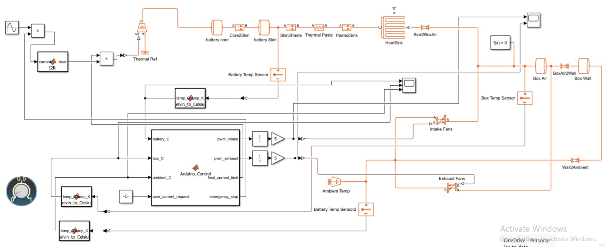
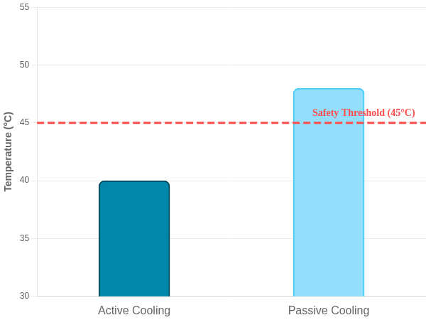

# Battery Thermal Management System

A team engineering project comparing passive and fan-assisted cooling for an automotive lithium-ion battery module. We used MATLAB and Simulink to study the thermal response and developed an Arduino-based controller for temperature monitoring and PWM fan control.

## Physical prototype

## Simulink models

### Passive cooling baseline

The baseline models the module's thermal response with the fans off.

### Fan-assisted cooling

The second model adds active airflow so we can compare the temperature response with the passive case.

## Simulation results

Under the simulated conditions shown in the project presentation, fan-assisted cooling held the temperature around **40 °C**, while the passive case exceeded the project's **45 °C design target**.

## Arduino monitoring and control

The controller monitors temperature and uses PWM to drive the cooling fans. The project also included alert and current-limiting logic for elevated temperatures.

[View the Arduino wiring diagram](docs/images/arduino-wiring.png)
